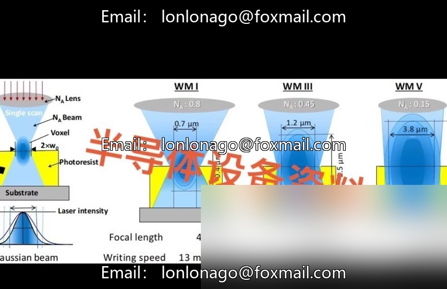
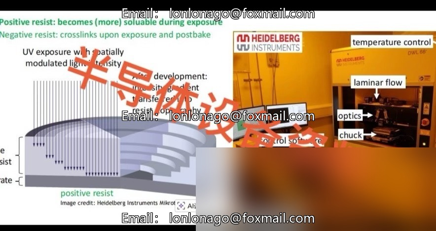
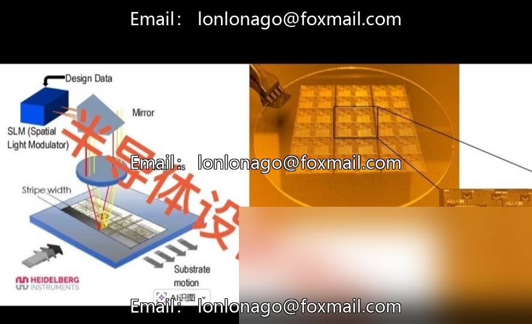
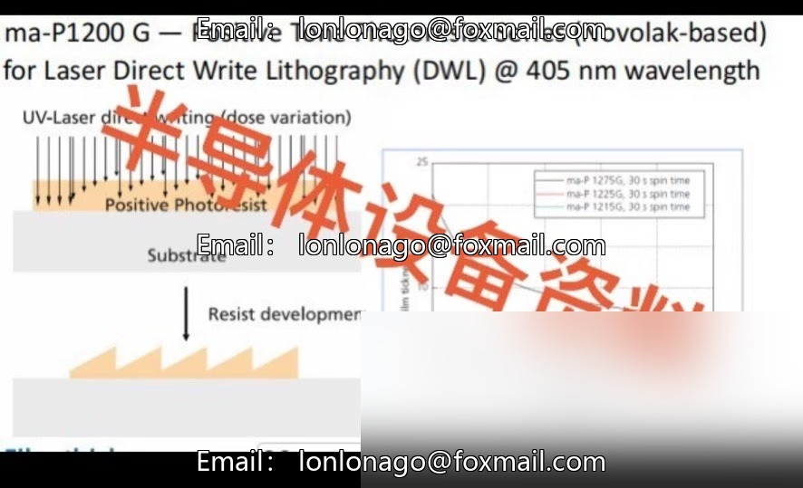
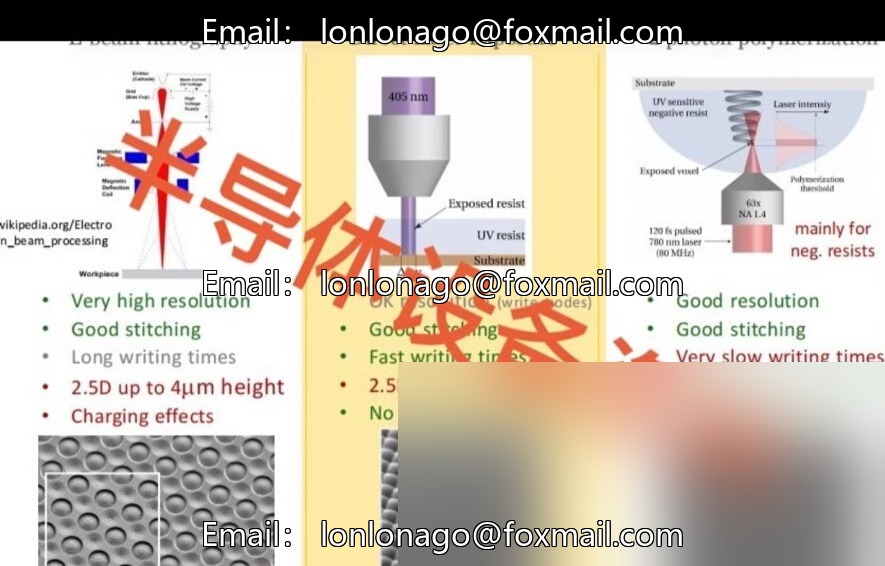

# Laser direct writing lithography technology materials: including curve shape technology - micro lens shape optimization technology

## Body

Laser direct write lithography technology material: including curvature linear technology - micro lens shape optimization technology etc., total 40 pages! Internal core technology training material!!

Capture and send directly to Cloud E-File! The following images contain a screenshot of the file portion. Please confirm before placing the order! Due to the replicable nature of electronic file data So after purchasing, return is not allowed! Thank you for understanding!

For personal learning and reference use only.

The material covers the curvature technique and micro-lens shape optimization for laser direct write lithography, along with various optical and imaging parameters.

<!-- AI_ENRICHED -->

## Images

## Payment

Here is a pay link on Stripe ( https://buy.stripe.com/3cs8yP7sY87d0vu9AB ). Please contact me lonlonago@foxmail.com after funding $89, and I will send you a complete data files , thank you!

